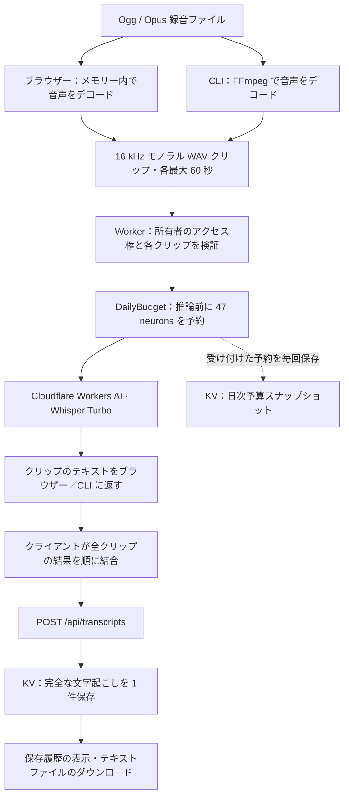
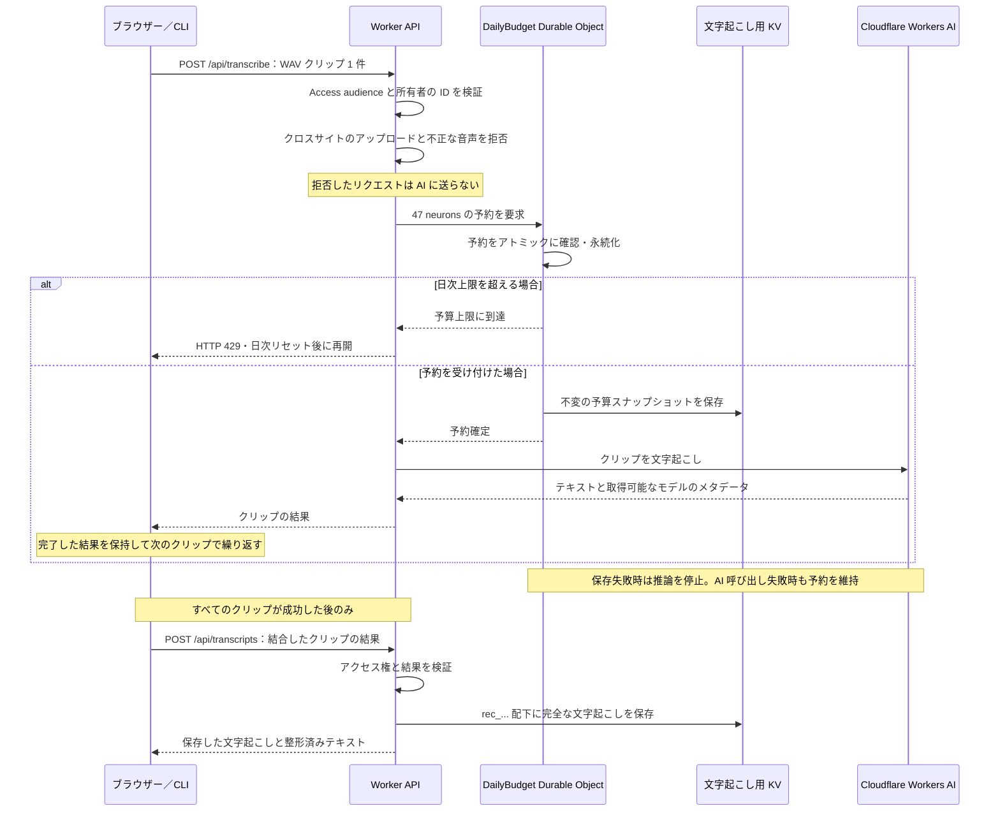

# WorkerWhisper

[English](README.md) | **日本語** | [繁體中文](README.zh-TW.md)

Ogg / Opus 音声の文字起こしと、その履歴の保存を行う小さな Cloudflare Worker です。製品名はモデル名とは独立しています。現在は Workers AI 経由で `@cf/openai/whisper-large-v3-turbo` を使用します。

**文字起こし速度の目安：**ブラウザーと CLI は完了したクリップから速度を推定します。例えば、60 秒の音声のアップロードと文字起こしに 10 秒かかる場合、速度は約 **6 倍速**で、30 分の録音には約 **5 分**とデコード・最終保存の時間が必要です。これは計算例であり、実測ベンチマークではありません。実際の速度は録音内容、ネットワーク、Cloudflare AI の負荷によって変わります。

自分の Cloudflare アカウントに非公開のインスタンスをセルフホストできます。各デプロイには独立した所有者、文字起こしストレージ、AI 予算があります。自分の Cloudflare 認証情報を使用し、利用料金を負担します。公開リポジトリはコードを提供するもので、メンテナーが文字起こしサービスをホストするものではありません。

## 仕組み

ブラウザーで録音ファイルを選ぶか、CLI にファイルのパスを渡します。コンピューターが音声を短い WAV クリップに変換し、順番にアップロードして、返されたテキストを結合します。Worker はアクセス権を確認して日次予算を予約した後、音声を Cloudflare AI に送信します。



このプロジェクトの利用に公開デプロイは**不要**です。ローカルモードでは Worker が手元のコンピューターで動作しますが、AI モデルは Cloudflare 上で動作し、アカウントの利用枠を消費します。

| | ローカルモード | デプロイモード |
|---|---|---|
| 起動 | `npm run dev` | Access を設定してから `npm run deploy` |
| エンドポイント | ループバック上の `http://localhost:8787` | 保護された HTTPS エンドポイント |
| アクセス | 開発用に所有者の ID をシミュレート | 所有者のログイン、または明示的に許可したサービストークン |
| AI 推論 | リモートの Cloudflare Workers AI | リモートの Cloudflare Workers AI |
| 文字起こしと予算の状態 | ローカルの KV と Durable Object ストレージ | Cloudflare の KV と Durable Object ストレージ |

ローカルとデプロイ先の予算は別々です。リポジトリ内の設定では公開 Worker URL とプレビュー URL を無効にしています。本番環境には実際の Access アプリケーションの audience と所有者向けポリシーが必要です。

### アップロードごとの処理



予算は**台湾時間 08:00 / UTC 00:00** にリセットされます。`GET /api/usage` は Durable Object の正式な状態を読み取り、ページの予算表示に使用します。KV は履歴のコピーを保持しますが、クリップを許可するかどうかは判断しません。表示されるのは、このアプリの保守的な予約量であり、Cloudflare アカウント全体の請求額ではありません。

### 保存するデータと再開方法

| 場所 | 保存するデータ | 再開方法 |
|---|---|---|
| ブラウザーのメモリー | デコードした音声と完了したクリップの結果 | ページを開いたまま **Retry / Resume** を使用。再読み込みや終了で進捗は失われます |
| CLI の出力ディレクトリ | `audio.pcm`、`job.json`、`partial.txt`、最終的な `transcript.txt` | 同じコマンドを再実行し、チェックポイントから完了済みクリップを読み込みます |
| 文字起こし用 KV | `rec_...` 配下の全文とメタデータ、`budget:YYYY-MM-DD:NNNNNN` 配下の予算スナップショット | 保存履歴から完了した文字起こしを表示します |
| Durable Object ストレージ | 日次予約回数と予約済み neurons | Worker の再起動や同時リクエスト後も上限を適用します |

音声クリップは処理のために Cloudflare に送信されますが、Worker は音声を KV に保存しません。CLI はデコードした音声をローカルに保持します。クリップが失敗しても完了した結果は再開に利用でき、履歴に保存するのはすべて結合された文字起こしだけです。応答が失われると推論や最終保存の繰り返しが必要になる場合があるため、再試行で追加の予約枠を消費したり、重複した文字起こしが作成されたりすることがあります。

## 実行

リポジトリをクローンまたはダウンロードした後、そのディレクトリで以下を実行してください。更新時は既存の `wrangler.jsonc` を保持し、新規インストール時だけテンプレートをコピーします。CLI とその統合テストには FFmpeg が必要です。

```sh
npm ci
cp wrangler.example.jsonc wrangler.jsonc
npx wrangler login
npm run check
npm test
npm run dev
```

Node.js 22.18 以降と、Workers AI が有効な Cloudflare アカウントが必要です。ローカル開発でもリモートの Workers AI 推論を使用するため、料金が発生する場合があります。`wrangler dev` では KV データはローカルに保存されます。

## 設定とデプロイ

**ホスティング時の注意：**公開前に、Cloudflare Access がデプロイ全体を自分だけに制限し、未認証のリクエストが文字起こしを読んだり AI 推論を実行したりできないことを確認してください。誰でも利用できるインスタンスは悪用され、高額な Cloudflare 料金が発生する可能性があります。このアプリの日次 AI 予算は、Cloudflare のすべての料金を制限するものではありません。

AI binding と TRANSCRIPTS namespace は `wrangler.jsonc` で設定します。テンプレートは `wrangler.example.jsonc` です。`wrangler.example.jsonc` を `wrangler.jsonc` にコピーしてください。アカウント内に namespace を作成するには、次を実行します。

```sh
npx wrangler login
npx wrangler kv namespace create TRANSCRIPTS
```

返された namespace ID を `wrangler.jsonc` に設定します。新規デプロイでは `name` を未使用の Worker 名に、`vars.OWNER_EMAIL` を自分のログイン用メールアドレスに設定します。Cloudflare アカウントで管理するドメインのホスト名（例：`transcribe.example.com`）に Cloudflare Access のセルフホストアプリケーションを作成し、パスを限定せずホスト名全体を保護します。自分のメールだけを許可し、アプリケーションの AUD を `vars.ACCESS_AUD` に設定してください。`wrangler.jsonc` のトップレベルに以下を追加し、ホスト名を自分のものに置き換えます。

```jsonc
"routes": [{ "pattern": "transcribe.example.com", "custom_domain": true }]
```

`workers_dev` と `preview_urls` は無効のままにしてください。以下の Access 確認を完了してから `npm run deploy` を実行し、設定した HTTPS ホスト名を開きます。Custom Domains には自分の Cloudflare アカウントの有効な zone が必要です。[Custom Domains](https://developers.cloudflare.com/workers/configuration/routing/custom-domains/) を参照してください。

Worker は履歴やアップロードを含むすべてのルートで Cloudflare Access 認証を要求します。Cloudflare の信頼できる `ctx.access` audience を確認するため、ID ヘッダーの偽装ではアクセスできません。また、認証済み所有者のメールアドレス（`OWNER_EMAIL`、例：`owner@example.com`）も確認します。ほかのログイン済みユーザーは拒否されます。同じ非公開履歴を利用できるのは、明示的に設定された所有者のサービストークンだけです。

本番 URL を有効にする前に：

1. **Workers & Pages → your Worker → Access** で、本番とプレビューの両方を含めて Worker を保護します。自分の正確なメールアドレスだけを許可する Allow ポリシーを設定し、Everyone や Bypass ルールは使わないでください。ホスト名ベースのアプリケーションでは `/api/*` を含むホスト名全体を対象にし、すべての別ルートも保護します。
2. アプリケーションの audience（AUD）タグを `wrangler.jsonc` の `vars.ACCESS_AUD` にコピーします。リポジトリ内の `workerwhisper-local` は開発用の仮の値です。audience が未設定なら 503、Access 認証がないか一致しなければ 403 を返します。
3. CLI またはローカルサーバー用に Access サービストークンを作成し、そのトークンだけを許可する **Service Auth** ポリシーを設定します。`vars.ALLOWED_SERVICE_TOKEN_ID` をその Client ID に設定します。Worker は信頼できる Access ID の `service_token_id` と `service_token_status` を検証します。この設定がない場合、本番のサービストークンリクエストは拒否されます。トークンはローカル環境に保持し、Git、URL、ブラウザーの JavaScript、文字起こしのメタデータには絶対に含めないでください。
4. デプロイ後、未認証のリクエストが履歴を読んだり推論を実行したりできないことを確認し、その後で所有者のログインと CLI トークンの動作を確認します。リポジトリ内の設定では `workers_dev` と `preview_urls` は無効のままです。

ローカルの `wrangler dev` は `127.0.0.1` にバインドし、`access.dev.aud` で Access をシミュレートします。`ACCESS_AUD` または `OWNER_EMAIL` を変更した場合は、開発用 audience と ID のメールアドレスも同じ値に設定してください。このシミュレーションはローカルクライアントを認証しません。トンネルや LAN インターフェース経由で開発サーバーを公開しないでください。本番ではこの開発用シミュレーションを使用しません。[Cloudflare Access for Workers](https://developers.cloudflare.com/workers/configuration/cloudflare-access/) を参照してください。

非公開レスポンスは `Cache-Control: no-store` を使用し、フレームへの埋め込みを禁止し、リファラーを抑制します。ブラウザーからのクロスサイト POST は拒否します。認可されたブラウザー以外のクライアントは Origin ヘッダーなしで POST できます。以下の説明どおり、AI 呼び出しの前に毎回、日次予約上限を適用します。文字起こしには現在、自動有効期限や削除 API はありません。

## 日次予算と KV スナップショット

`DAILY_NEURON_CAP` の既定値は **UTC の 1 日あたり 10,000 neurons** で、1〜10,000 の整数を受け付けます。名前付きの SQLite ベースの Durable Object（`DailyBudget`）1 つが、推論前に**試行するクリップごとに 47 neurons を予約**します。予約は直列に処理するため、同時アップロードで同じ残り予算を使うことはできません。この上限では、1 日に最大 212 クリップ（予約量 9,964 neurons）を受け付けます。短い最終クリップも 47 を予約します。推論が失敗したり応答が失われたりしても、Cloudflare で課金された可能性があるため予約は維持されます。自動返還や自動再試行は行いません。

この上限は、現在の Whisper Turbo の音声 1 分あたり 46.63 neurons という料金を使い、この機能の有効化後に行う本アプリの呼び出しを保守的に見積もったものです。Cloudflare の請求メーターではありません。以前の呼び出し、ほかの Worker、ローカルとデプロイ先のセッションは別々に扱われるため、アプリの 10,000-neuron 上限ではアカウント全体の有料利用がゼロになることを保証できません。今日の残り無料枠内に収めたい場合は、ほかの利用量を考慮してアプリの上限を下げてください。モデルや料金を変更する際は、予約量を再確認してください。

`GET /api/usage` は現在の上限、予約済みと残りの neurons、リクエスト数、残りクリップ数、次のリセット時刻を返します。ページは初回読み込み時、Refresh 時、文字起こしの試行後にこの情報を取得します。リセット時刻は **UTC 00:00 / Asia/Taipei 08:00** です。上限に達すると Workers AI を呼ぶ前に HTTP 429 を返します。CLI／ブラウザーの完了済みクリップは翌日の再開に使えます。

予約を受け付けるたびに、既存の `TRANSCRIPTS` KV namespace の `budget:YYYY-MM-DD:NNNNNN` 配下に非公開スナップショットを書き込みます。別々の不変キーを使うことで、KV の同一キーへの書き込み競合を回避します。スナップショットには録音のテキストや認証情報を含めず、文字起こし履歴にも表示しません。上限を適用する根拠は Durable Object です。結果整合性を持つ KV のコピーは履歴用であり、アップロードの可否の判断には使いません。ストレージまたはスナップショットの書き込みに失敗すると推論を停止します。スナップショットと文字起こしには現在、自動有効期限はありません。

上限を検証できるように、`/api/transcribe` は現在、ブラウザー／CLI が生成する標準的な PCM16 WAV クリップだけを受け付けます。16 kHz、モノラル、最大 60 秒で、ファイル長とデータ長が整合している必要があります。元の Ogg/Opus ファイルは両方のインターフェースで引き続き利用できます。**未変換の Ogg/Opus を API に直接アップロードすることはできません**。先に CLI／ブラウザーで変換してください。既存の文字起こしは引き続き読み取れます。デプロイ時に設定済みの `DailyBudget` Durable Object migration が作成され、文字起こしの KV namespace は保持されます。

## CLI デモ（Ogg / Opus）

### 1. プロジェクトを準備する

Node.js 22.18 以降、PATH 上の FFmpeg、Workers AI が有効な Cloudflare アカウントが必要です。macOS で Homebrew を使って FFmpeg をインストールするには：

```sh
brew install ffmpeg
```

プロジェクトディレクトリでターミナルを開き、依存関係をインストールします。

```sh
npm ci
cp wrangler.example.jsonc wrangler.jsonc
node --version
ffmpeg -version
```

### 2. Worker を起動する

同じターミナルで Cloudflare にログインし、ローカル Worker を起動します。

```sh
npx wrangler login
npm run dev
```

このターミナルは実行したままにしてください。Wrangler がローカル URL を表示します。通常は `http://localhost:8787` です。

### 3. 録音をアップロードする

プロジェクトディレクトリで 2 つ目のターミナルを開きます。まず 2〜3 分の録音を使い、ファイルに合わせて次のいずれかを実行してください。

```sh
npm run demo -- ./meeting.opus
npm run demo -- ./meeting.ogg
```

ファイル名にスペースがある場合は、パスを引用符で囲みます。

```sh
npm run demo -- "/path/to/My meeting.opus"
```

文字起こしに録音開始時刻と計算した終了時刻を含めるには、タイムゾーンオフセット付きの実際の時刻を指定します。台湾の場合：

```sh
npm run demo -- ./demo.opus --recording-start "2026-01-01T12:00:00+08:00"
```

時刻はファイル名や更新日時から推測しません。指定しない場合、録音の開始時刻と終了時刻は `Unknown` になります。再開時は同じコマンドを使用するか、このオプションを省略して保存済みの開始時刻を維持してください。

スクリプトはローカルで音声をディスク上の 16 kHz モノラル PCM に変換し、連続する 60 秒ごとの区間を独立した PCM16 WAV にして、既存の Worker に順次アップロードします。進捗を表示して完了した応答をチェックポイントに保存し、最後に結合した文字起こしを Worker の履歴とローカルの `transcript.txt` に保存します。

たとえば 130 秒の録音は、60 秒、60 秒、10 秒の 3 クリップになります。元ファイルを自分で分割する必要はありません。

CLI とブラウザーは、クリップ完了後に実測した音声 1 秒あたりの処理時間から残り時間を推定します。再開した実行では、新しいクリップだけを使って速度を推定します。推定にデコードと最終保存は含めず、ネットワークや推論速度によって変動します。

### 4. 文字起こしを読む

既定の出力先は録音ファイルの隣にある `meeting.opus.workerwhisper-demo/` です。`audio.pcm`、`job.json`、クリップ成功後の `partial.txt`、完了後の `transcript.txt` が保存されます。これらの既定ディレクトリは Git の管理対象外です。PCM は音声 1 時間あたり約 115 MB を使用し、メモリー使用量は 1 クリップ分に抑えられます。音声と文字起こしが不要になったら、ディレクトリを削除してください。

```sh
cat ./meeting.opus.workerwhisper-demo/transcript.txt
```

WorkerWhisper への改名前に作成したジョブを再開するには、`--out ./meeting.opus.edgewhisper-demo` を指定して既存のチェックポイントディレクトリを使用してください。

### 5. エラー後に再開する

エラー後に同じコマンドを再実行すると、最初の未完了クリップから再開します。ターミナルを再起動した後でも可能です。入力ファイルや Worker URL が変わった場合は、新しい出力ディレクトリが必要です。完了済みのジョブは AI を再度呼ばずに終了します。プロセスを強制終了した場合は、ほかの実行がそのディレクトリを使っていないことを確認してから `running.lock` を削除してください。

再開時は出力ディレクトリを保持してください。`job.json` に完了済みクリップの応答が保存されています。Worker のターミナルを再起動した場合は、デモを再開する前に `npm run dev` を再実行します。

### オプションとトラブルシューティング

エンドポイントや出力先を指定するには（Wrangler が別のポートを表示した場合は `--url` を使用）：

```sh
npm run demo -- ./meeting.opus --url http://localhost:8787 --out ./meeting.opus.workerwhisper-demo
```

URL は Worker のオリジンである必要があります。リモートのオリジンには HTTPS と、Access サービストークンの環境変数 `CF_ACCESS_CLIENT_ID` および `CF_ACCESS_CLIENT_SECRET` の両方が必要です。ターミナルで安全に設定した後、次を実行します。

```sh
npm run demo -- ./meeting.opus --url https://your-protected-worker.example.com
```

認証情報は HTTP localhost エンドポイントには送信しません。アップロードや認証情報が別の送信先に転送されるのを防ぐため、リダイレクトは拒否します。CLI はブラウザーでの対話型ログインを行いません。[Access サービストークン](https://developers.cloudflare.com/cloudflare-one/access-controls/service-credentials/service-tokens/) を参照してください。

新しい CLI 出力ディレクトリとファイルは OS の自分のユーザーだけが利用できます（Unix ではディレクトリが 0700、ファイルが 0600）。既存のアクセス権は変更しません。デコードした音声、文字起こし、元ファイルの絶対パスが含まれるため、不要になったら削除してください。

ローカルの Workers AI 推論もアカウントの日次利用枠を消費します。自動再試行はありません。エラーを修正するか利用枠のリセットを待ち、再実行してください。推論後に応答が失われると、未完了クリップに再度課金される場合があります。最終保存の応答が失われると、再実行で重複した履歴が作成される場合があります。

### API で neuron 使用量を読む

Cloudflare の GraphQL Analytics API は、`aiInferenceAdaptiveGroups.sum.totalNeurons` でアカウント全体の Workers AI 使用量を公開します。モデルや Worker で絞り込まず、UTC 当日の `00:00:00Z` から現在時刻までを問い合わせてください。分析データの読み取り権限を持つアカウントスコープの API トークンを使用します。

`Authorization: Bearer <token>` を付け、`query` と `variables` を含む JSON 本文で、このクエリを `https://api.cloudflare.com/client/v4/graphql` に送信します。

```graphql
query($account: string!, $start: Time!, $end: Time!) {
  viewer {
    accounts(filter: {accountTag: $account}) {
      aiInferenceAdaptiveGroups(
        limit: 1,
        filter: {datetime_geq: $start, datetime_lt: $end}
      ) {
        sum { totalNeurons }
      }
    }
  }
}
```

10,000 から報告された合計を引き、最低値をゼロにすると、残りの無料枠になります。46.63 で割ると、Whisper Turbo で処理できる音声の残り分数を推定できます。これは遅延やサンプリングの可能性がある分析結果であり、リアルタイムの予約や支出上限ではありません。HTTP ステータスが 200 でも GraphQL の `errors` を確認してください。API エラーを使用量ゼロと解釈してはいけません。分析用の認証情報をブラウザーのコードに含めないでください。[GraphQL クエリの基本](https://developers.cloudflare.com/analytics/graphql-api/getting-started/querying-basics/) と [Workers AI の料金](https://developers.cloudflare.com/workers-ai/platform/pricing/) を参照してください。

- **FFmpeg の失敗：** `ffmpeg -version` が動作し、録音ファイルを開けることを確認してください。
- **Connection refused / fetch failed：** `npm run dev` を起動し、`--url` が Wrangler のローカル URL と一致していることを確認してください。
- **利用枠の消費：** 無料枠は 1 日あたり 10,000 neurons で、アカウントの Workers AI 利用全体で共有されます。Asia/Taipei 08:00 にリセットされます。音声を分割しても、課金対象の音声の合計分数は減りません。[Cloudflare の料金](https://developers.cloudflare.com/workers-ai/platform/pricing/) を参照してください。
- **元ファイルや Worker URL の変更：** 別のジョブの進捗を流用せず、新しい `--out` ディレクトリを選んでください。

CLI の全オプションは `npm run demo -- --help` で確認できます。

## ブラウザーデモ

`npm run dev` を実行した状態で、Wrangler が表示するローカル URL を開きます。

1. `.ogg` または `.opus` ファイルを選びます。
2. 必要に応じて録音開始時刻を入力します。
3. **Upload & Transcribe** をクリックします。ブラウザーが自動でクリップを分割してアップロードします。
4. クリップの進捗と途中のテキストを確認し、**Download transcript (.txt)** をクリックします。

ページは開いたままにしてください。エラー後は **Retry / Resume** を使用します。ブラウザーの進捗は再読み込みや終了で失われます。CLI は進捗をディスクに保存するため、再起動後も再開できます。

## 動作

- 10 MiB を超えるファイルを含め、`.ogg` または `.opus` を選択できます。ブラウザーは録音を 16 kHz でデコードし、モノラルにミックスして、60 秒の PCM16 WAV クリップ（各約 1.92 MB）を順番に送信します。Worker の音声リクエスト 1 件あたりの上限は引き続き 10 MiB です。元の音声は保存しません。
- モデルが自動検出できるよう、言語は指定しません。初期プロンプトには繁体字中国語、英語、タイ語、フィリピノ語の文脈を含めています。これは指針であり、言語の切り替えの正確な認識や繁体字中国語の出力を保証するものではありません。
- クリップのテキストは順に結合し、合計文字起こし時間と、取得できる場合は単語数を含め、1 件の文字起こしとして保存します。結合した文字起こしには VTT はありません。単一クリップのアップロードにはモデルの VTT 出力が含まれる場合があります。履歴は新しい順に 1 ページ 20 件で表示し、カーソルで続きを取得します。
- KV は結果整合性を持つため、新しい文字起こしが履歴に表示されたり、ほかの場所から読めたりするまで時間がかかる場合があります。

モデルスキーマ：https://developers.cloudflare.com/workers-ai/models/whisper-large-v3-turbo/

## 文字起こしのダウンロード

文字起こし後、または履歴の表示中に「Download transcript (.txt)」を使用します。ファイル名は `cloud-YYMMDD-HHMMSS_{original_filename}.txt` で、元ファイルの拡張子を含みます。タイムスタンプは文字起こしリクエスト開始時の Asia/Taipei 時刻で、後からダウンロードしても変わりません。

テキストにはメタデータと文字起こしのセクションが含まれます。任意の録音開始フィールドはブラウザーのローカル時刻を使用します。終了時刻はデコードした音声の長さから計算します（単一クリップを API に直接アップロードした場合は検証済みの WAV の長さ）。不明なメタデータは Unknown と表示します。音声サイズはアップロードしたファイルを十進数の MB で表し、文字起こし時間は AI 呼び出しの時間を計測します。変換フィールドには 60 秒の WAV クリップと記載し、ディスク上に変換ファイルがあると偽ったり、CUDA デバイスを使用したと記載したりはしません。

録音開始時刻が指定されていれば、タイトルの日付にはその Asia/Taipei 日付を使用します。未指定なら文字起こしリクエストの日付を使用します。ダウンロードファイル名には引き続きリクエストのタイムスタンプを使用します。CLI は元ファイルの絶対パスを含めます。ブラウザーでは取得できないため、ブラウザーのエクスポートではそのフィールドは Unknown になります。エクスポートするすべてのタイムスタンプは Asia/Taipei を使用します。

レイアウト例（値は例示です。エクスポートのフィールド名は英語のままです）：

```text
Voice Memo Transcript - 20260101

## Metadata
Recording Start Time: 2026-01-01 12:00
Recording End Time: 2026-01-01 12:02
Source File: demo.opus
Source Location: /recordings/demo.opus
Converted Audio: 60-second WAV chunks (16 kHz, mono, PCM16)
Audio Size: 3.00 MB
Audio Length: 2.00 min
Transcribe Backend: Cloudflare Workers AI
Transcribe Device: Cloudflare-managed
Transcribe Model: @cf/openai/whisper-large-v3-turbo
Transcribe Time: 0m 30s
Recording Timezone: Asia/Taipei

## Transcript
Transcribed text goes here.
```

リポジトリ内の設定では公開 URL は無効のままです。有効にする前に、本番用の Access ポリシーと audience を適用してください。

## 長時間の録音

ページはクリップの進捗を表示し、完了した結果をメモリーに保持します。クリップや最終保存が失敗した場合は、ページを開いたまま Retry / Resume を使用してください。完了したクリップは再度文字起こししません。失敗後は途中のテキストをダウンロードできます。ページを閉じたり再読み込みしたりすると、メモリー上のジョブは失われます。KV に保存するのは、完全に結合した文字起こしだけです。

ブラウザーでのデコードには Ogg/Opus コーデックのサポートと、録音全体のデコード結果を保持できるメモリーが必要です。分割はアップロードと Worker のメモリー使用量を減らしますが、ブラウザーのデコードに必要なメモリーは減らしません。ブラウザー API はファイル全体を必要とします：https://developer.mozilla.org/en-US/docs/Web/API/BaseAudioContext/decodeAudioData

クリップは重なりなく連続しているため、境界の単語は文脈を失う場合があります。これが精度に影響する場合、次の改善案は無音区間での分割です。現在の上限は 1,000 クリップ（1,000 分）と、最終 JSON リクエストの 2 MiB です。

## ライセンス

[MIT](LICENSE).
