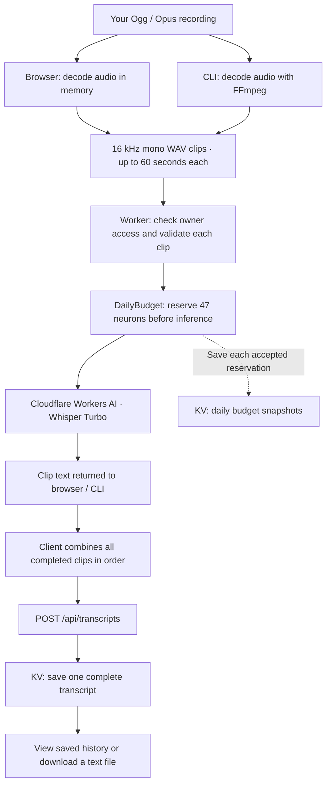
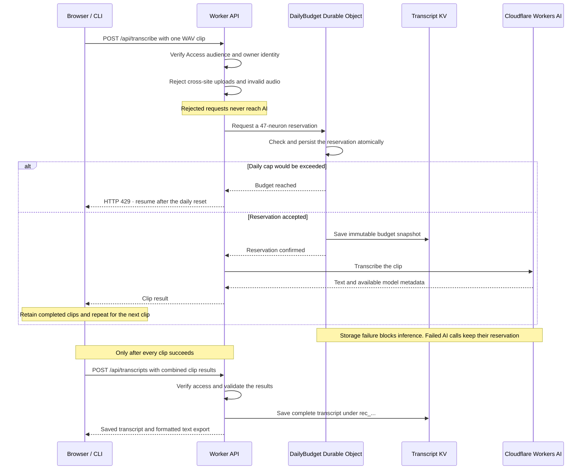

# WorkerWhisper

**English** | [日本語](README.ja.md) | [繁體中文](README.zh-TW.md)

[Explore the website](https://myread02.github.io/WorkerWhisper/) · [View the project on GitHub](https://github.com/myread02/WorkerWhisper)

A small Cloudflare Worker for Ogg / Opus transcription and saved transcript history. The product name is independent of the model: it currently uses `@cf/openai/whisper-large-v3-turbo` through Workers AI.

**Estimated transcription speed:** The browser and CLI estimate speed from completed clips. For example, if a 60-second clip takes 10 seconds to upload and transcribe, the rate is about **6× real time**: a 30-minute recording would take about **5 minutes**, plus decoding and final saving. This is a calculation example, not a measured benchmark; actual speed depends on the recording, network, and Cloudflare AI load.

Self-host your own private instance in your Cloudflare account. Each deployment has its own owner, transcript storage, and AI budget. You provide your own Cloudflare credentials and pay for your own usage. The public repository shares the code; the maintainer does not provide a hosted transcription service.

## How it works

Choose a recording in the browser or pass its path to the CLI. Your computer converts it into small WAV clips, uploads them one at a time, and combines the returned text. The Worker checks access and reserves the daily budget before sending any audio to Cloudflare AI.



You do **not** need a public deployment to use the project. Local mode runs the Worker on your computer, but the AI model still runs at Cloudflare and consumes your account's allowance.

| | Local mode | Deployed mode |
|---|---|---|
| Start | `npm run dev` | Configure Access, then `npm run deploy` |
| Endpoint | `http://localhost:8787` on loopback | Your protected HTTPS endpoint |
| Access | Simulated owner identity for development | Owner login or explicitly allowed service token |
| AI inference | Remote Cloudflare Workers AI | Remote Cloudflare Workers AI |
| Transcripts and budget state | Local KV and Durable Object storage | Cloudflare KV and Durable Object storage |

Local and deployed budgets are separate. The checked-in configuration disables public Worker and preview URLs; production requires your real Access application audience and owner policy.

### What happens to each upload



The budget resets at **08:00 Taiwan time / 00:00 UTC**. `GET /api/usage` reads the authoritative Durable Object state for the page's budget display. KV keeps a historical copy; it does not decide whether a clip is allowed. The display tracks this app's conservative reservations, not account-wide Cloudflare billing.

### What gets saved, and how to resume

| Location | Saved data | Resume behavior |
|---|---|---|
| Browser memory | Decoded audio and completed clip results | Keep the page open and use **Retry / Resume**; refresh or close loses progress |
| CLI output directory | `audio.pcm`, `job.json`, `partial.txt`, and final `transcript.txt` | Rerun the same command; completed clips are read from the checkpoint |
| Transcript KV | Complete text and metadata under `rec_...`; budget snapshots under `budget:YYYY-MM-DD:NNNNNN` | View completed transcripts through saved history |
| Durable Object storage | Daily reservation count and reserved neurons | Cap enforcement survives Worker restarts and concurrent requests |

Audio clips are sent to Cloudflare for processing but are not saved by the Worker in KV. The CLI keeps its decoded audio locally. A failed clip leaves completed results available to resume; only a complete combined transcript is saved to history. A lost response can require repeating an inference or final save, so retries can consume another reservation or create a duplicate transcript.

## Run

After cloning or downloading this repository, run these commands from its directory. Keep an existing `wrangler.jsonc` when upgrading; copy the template only for a new installation. FFmpeg is required for the CLI and its integration test.

```sh
npm ci
cp wrangler.example.jsonc wrangler.jsonc
npx wrangler login
npm run check
npm test
npm run dev
```

Requires Node.js 22.18+ and a Cloudflare account with Workers AI enabled. Local development uses remote Workers AI inference, which can incur charges; KV data stays local with `wrangler dev`.

## Configure and deploy

**Hosting warning:** Before going live, verify that Cloudflare Access restricts the entire deployment to you and that unauthenticated requests cannot read transcripts or trigger AI inference. A publicly accessible instance can be abused and generate a large Cloudflare bill; the app's daily AI budget does not cap all Cloudflare charges.

The AI binding and TRANSCRIPTS namespace are configured in `wrangler.jsonc` (template provided in `wrangler.example.jsonc`). Copy `wrangler.example.jsonc` to `wrangler.jsonc`. To create a namespace in your account:

```sh
npx wrangler login
npx wrangler kv namespace create TRANSCRIPTS
```

Set the returned namespace ID in `wrangler.jsonc`. For a new deployment, set `name` to an unused Worker name and `vars.OWNER_EMAIL` to your login email. Create a Cloudflare Access self-hosted application for a hostname in a domain managed by your Cloudflare account (for example, `transcribe.example.com`), covering the entire hostname with no path restriction. Allow only your email, then copy its AUD into `vars.ACCESS_AUD`. Add this top-level setting to `wrangler.jsonc`, replacing the example hostname with your own:

```jsonc
"routes": [{ "pattern": "transcribe.example.com", "custom_domain": true }]
```

Keep `workers_dev` and `preview_urls` disabled. Complete the Access checks below, then run `npm run deploy` and open your configured HTTPS hostname. Custom Domains require an active zone in your Cloudflare account. See [Custom Domains](https://developers.cloudflare.com/workers/configuration/routing/custom-domains/).

The Worker requires Cloudflare Access authentication on every route, including history and uploads. It checks Cloudflare's trusted `ctx.access` audience; forged identity headers do not grant access. The Worker also checks the authenticated owner email (`OWNER_EMAIL`, such as `owner@example.com`). Other signed-in users are rejected. Only an explicitly configured owner service token may use the same private history.

Before enabling a production URL:

1. Protect this Worker in **Workers & Pages → your Worker → Access**, covering production and previews. Set an Allow policy for your exact email, without an Everyone or Bypass rule. For a hostname-based application, cover the entire hostname, including `/api/*`, and protect every alternate route too.
2. Copy the application's audience (AUD) tag into `vars.ACCESS_AUD` in `wrangler.jsonc`. The checked-in `workerwhisper-local` value is a development placeholder. A missing audience returns 503; missing or mismatched Access authentication returns 403.
3. For the CLI or a local server, create an Access service token and a **Service Auth** policy allowing only that token. Set `vars.ALLOWED_SERVICE_TOKEN_ID` to its Client ID; the Worker verifies `service_token_id` and `service_token_status` from the trusted Access identity. Without this setting, production service-token requests are denied. Keep the token in your local environment; never put it in Git, a URL, browser JavaScript, or transcript metadata.
4. Deploy and verify that unauthenticated requests cannot read history or trigger inference, then verify your owner login and CLI token work. `workers_dev` and `preview_urls` remain disabled in the checked-in config.

Local `wrangler dev` binds to `127.0.0.1` and simulates Access via `access.dev.aud`. If you change `ACCESS_AUD` or `OWNER_EMAIL`, set the development audience and identity email to the same values. The simulation does not authenticate local clients: do not expose the development server through a tunnel or a LAN interface. Production does not use this development simulation. See [Cloudflare Access for Workers](https://developers.cloudflare.com/workers/configuration/cloudflare-access/).

Private responses use `Cache-Control: no-store`, disable framing, and suppress referrers. Cross-site browser POST requests are rejected. Authorized non-browser clients can POST without an Origin header. A daily reservation cap is enforced before every AI call, as described below. Transcripts currently have no automatic expiry or delete API.

## Daily budget and KV snapshots

`DAILY_NEURON_CAP` defaults to **10,000 neurons per UTC day** and accepts integer values from 1 through 10,000. One named SQLite-backed Durable Object (`DailyBudget`) reserves **47 neurons per attempted clip** before inference. Reservations are serialized, so concurrent uploads cannot spend the same remaining budget. At this cap, at most 212 clips are accepted daily (9,964 reserved neurons). Even a short final clip reserves 47; failed or lost inference responses retain their reservation because Cloudflare may have charged for them. No automatic refunds or retries.

The cap is a conservative estimate for this app's calls after this feature is enabled, using the current Whisper Turbo rate of 46.63 neurons per audio minute. It is not Cloudflare's billing meter. Earlier calls, other Workers, and local versus deployed sessions have separate usage; a 10,000-neuron app cap does not guarantee zero account-wide paid usage. If you need to stay within today's remaining free allowance, lower the app cap to leave room for that other usage. Recheck the reservation amount when changing models or pricing.

`GET /api/usage` returns the current cap, reserved and remaining neurons, request count, remaining clips, and next reset timestamp. The page loads it initially, on Refresh, and after transcription attempts. Reset occurs at **00:00 UTC / 08:00 Asia/Taipei**. Reaching the cap returns HTTP 429 before calling Workers AI; completed CLI/browser clips remain available for resume the next day.

Each accepted reservation writes a private snapshot into the existing `TRANSCRIPTS` KV namespace under `budget:YYYY-MM-DD:NNNNNN`. Separate immutable keys avoid KV's per-key write contention. These snapshots contain no recording text or credentials and do not appear in transcript history. The Durable Object is the enforcement source; KV's eventually consistent copy is for history, not for deciding whether an upload may proceed. A storage or snapshot-write failure blocks inference. Snapshots and transcripts currently have no automatic expiry.

To make the cap verifiable, `/api/transcribe` now accepts only the canonical PCM16 WAV clips generated by the browser/CLI: 16 kHz, mono, and at most 60 seconds, with consistent file and data lengths. Ogg/Opus source files still work through both interfaces. **Direct raw Ogg/Opus API uploads are no longer accepted**; use the CLI/browser conversion first. Existing saved transcripts remain readable. Deploying creates the configured `DailyBudget` Durable Object migration; the transcript KV namespace is preserved.

## CLI demo (Ogg / Opus)

### 1. Prepare the project

Requires Node.js 22.18+, FFmpeg on your PATH, and a Cloudflare account with Workers AI enabled. On macOS with Homebrew, install FFmpeg:

```sh
brew install ffmpeg
```

Open a terminal in the project directory and install its dependencies:

```sh
npm ci
cp wrangler.example.jsonc wrangler.jsonc
node --version
ffmpeg -version
```

### 2. Start the Worker

In the same terminal, authenticate with Cloudflare and start the local Worker:

```sh
npx wrangler login
npm run dev
```

Keep this terminal running. Wrangler prints the local URL, usually `http://localhost:8787`.

### 3. Upload your recording

Open a second terminal in the project directory. Start with a 2–3-minute recording and run one of these commands for your file:

```sh
npm run demo -- ./meeting.opus
npm run demo -- ./meeting.ogg
```

For a filename containing spaces, quote its path:

```sh
npm run demo -- "/path/to/My meeting.opus"
```

To include the recording start and calculated end time in the transcript, supply its actual timestamp with a timezone offset. For Taiwan:

```sh
npm run demo -- ./demo.opus --recording-start "2026-01-01T12:00:00+08:00"
```

The timestamp is not inferred from the filename or file modification time. Without it, recording start and end are `Unknown`. Resume with the same command, or omit the option to keep the stored start time.

The script converts audio locally to 16 kHz mono PCM on disk, wraps each consecutive 60-second slice as an independent PCM16 WAV, and uploads clips sequentially to the existing Worker. It prints progress, checkpoints completed responses, then saves the combined transcript in the Worker's history and locally as `transcript.txt`.

For example, a 130-second recording produces three clips: 60 seconds, 60 seconds, and 10 seconds. You do not need to split the source file yourself.

The CLI and browser show estimated time remaining after completed clips, using observed elapsed time per audio second. A resumed run uses only new clips to estimate speed. The estimate excludes decoding and the final save, and varies with network and inference speed.

### 4. Read the transcript

Output defaults to `meeting.opus.workerwhisper-demo/` beside the recording. It contains `audio.pcm`, `job.json`, `partial.txt` after successful clips, and `transcript.txt` after completion. These default directories are Git-ignored. PCM takes about 115 MB per audio hour; memory usage stays bounded to a clip. Delete the directory when you no longer need the audio and transcript.

```sh
cat ./meeting.opus.workerwhisper-demo/transcript.txt
```

To resume a job created before the WorkerWhisper rename, pass `--out ./meeting.opus.edgewhisper-demo` to use its existing checkpoint directory.

### 5. Resume after an error

Rerun the same command after an error to resume from the first unfinished clip, including after restarting the terminal. Changed input files or Worker URLs require a new output directory. A completed job exits without repeating AI calls. If the process was forcibly killed, remove its `running.lock` only after confirming no other run is using that directory.

Keep the output directory when resuming; `job.json` contains the completed clip responses. If you restarted the Worker terminal, run `npm run dev` again before resuming the demo.

### Options and troubleshooting

To choose the endpoint or output location (use `--url` if Wrangler prints a different port):

```sh
npm run demo -- ./meeting.opus --url http://localhost:8787 --out ./meeting.opus.workerwhisper-demo
```

The URL must be the Worker origin. Remote origins require HTTPS and both `CF_ACCESS_CLIENT_ID` and `CF_ACCESS_CLIENT_SECRET` environment variables from your Access service token. With those securely set in your terminal, run:

```sh
npm run demo -- ./meeting.opus --url https://your-protected-worker.example.com
```

Credentials are not sent to HTTP localhost endpoints, and redirects are refused to avoid forwarding uploads or credentials to another destination. The CLI does not perform interactive browser login. See [Access service tokens](https://developers.cloudflare.com/cloudflare-one/access-controls/service-credentials/service-tokens/).

New CLI output directories and files are restricted to your OS user (0700 directories, 0600 files on Unix); existing permissions are not changed. They still contain decoded audio, transcripts and your absolute source path, so delete them when no longer needed.

Local Workers AI inference consumes your account's daily allowance. There are no automatic retries: fix the error or wait for quota reset, then rerun. If a response is lost after inference, the unfinished clip may be charged again; if a final save response is lost, rerunning may create a duplicate history record.

### Read neuron usage through the API

Cloudflare's GraphQL Analytics API exposes account-wide Workers AI usage through `aiInferenceAdaptiveGroups.sum.totalNeurons`. Query the UTC day from `00:00:00Z` through the current time, without filtering by model or Worker. Use an account-scoped API token with permission to read analytics.

Send this query to `https://api.cloudflare.com/client/v4/graphql` using `Authorization: Bearer <token>` and a JSON body containing `query` and `variables`:

```graphql
query($account: string!, $start: Time!, $end: Time!) {
  viewer {
    accounts(filter: {accountTag: $account}) {
      aiInferenceAdaptiveGroups(
        limit: 1,
        filter: {datetime_geq: $start, datetime_lt: $end}
      ) {
        sum { totalNeurons }
      }
    }
  }
}
```

Subtract the reported total from 10,000 and clamp at zero for the remaining free allowance. Divide by 46.63 to estimate remaining Whisper Turbo audio minutes. This is reported analytics, which may lag or be sampled, not a real-time reservation or a spending limit. Check GraphQL `errors` even when HTTP status is 200; an API error must not be interpreted as zero usage. Keep analytics credentials outside browser code. See [GraphQL querying basics](https://developers.cloudflare.com/analytics/graphql-api/getting-started/querying-basics/) and [Workers AI pricing](https://developers.cloudflare.com/workers-ai/platform/pricing/).

- **FFmpeg failed:** verify `ffmpeg -version` works and the recording can be opened.
- **Connection refused / fetch failed:** start `npm run dev` and check that `--url` matches Wrangler's local URL.
- **Quota exhausted:** the free allocation is 10,000 neurons per day, shared across your account's Workers AI usage. It resets at 08:00 Asia/Taipei. Splitting audio does not reduce the total audio minutes billed. See [Cloudflare pricing](https://developers.cloudflare.com/workers-ai/platform/pricing/).
- **Source file or Worker URL changed:** select a new `--out` directory instead of reusing another job's progress.

For all CLI options, run `npm run demo -- --help`.

## Browser demo

With `npm run dev` running, open the local URL printed by Wrangler:

1. Select an `.ogg` or `.opus` file.
2. Optionally enter the recording start time.
3. Click **Upload & Transcribe**. The browser splits and uploads clips automatically.
4. Watch clip progress and partial text, then click **Download transcript (.txt)**.

Keep the page open. Use **Retry / Resume** after an error; browser progress is lost on refresh or close. The CLI saves progress to disk and can resume after restarting.

## Behavior

- Select `.ogg` or `.opus` files, including files larger than 10 MiB. The browser decodes the recording at 16 kHz, mixes it to mono, and sends sequential 60-second PCM16 WAV clips (about 1.92 MB each). The Worker retains a 10 MiB limit per audio request; original audio is not stored.
- Language is omitted so the model can detect it. The initial prompt provides Traditional Chinese, English, Thai and Filipino context. This is guidance, not a guarantee of accurate code-switching or Traditional Chinese output.
- Clip text is combined in order and saved as one transcript, with total transcription time and word count when available. Combined transcripts have no VTT; single-clip uploads may include model VTT output. History lists newest records first, 20 per page, with a cursor for more.
- KV is eventually consistent: new transcripts may take time to appear in history or be readable in other locations.

Model schema: https://developers.cloudflare.com/workers-ai/models/whisper-large-v3-turbo/

## Transcript downloads

Use “Download transcript (.txt)” after transcribing or viewing history. Files are named `cloud-YYMMDD-HHMMSS_{original_filename}.txt`, including the source extension. The timestamp is the transcription request start in Asia/Taipei; it stays the same on later downloads.

The text includes metadata and a transcript section. An optional recording start field uses your browser's local time; the end is calculated from the decoded audio duration (or validated WAV duration for direct single-clip API uploads). Missing metadata is marked Unknown. Audio size describes the uploaded file in decimal MB, and transcription time measures the AI call. The conversion field reports 60-second WAV chunks, without inventing a converted file stored on disk or claiming a CUDA device.

The title date uses the recording start date in Asia/Taipei when supplied; otherwise it uses the transcription request date. Download filenames continue to use the request timestamp. The CLI includes the absolute source path; browsers cannot expose it, so browser exports mark that field Unknown. All exported timestamps use Asia/Taipei.

Example layout (values below are illustrative):

```text
Voice Memo Transcript - 20260101

## Metadata
Recording Start Time: 2026-01-01 12:00
Recording End Time: 2026-01-01 12:02
Source File: demo.opus
Source Location: /recordings/demo.opus
Converted Audio: 60-second WAV chunks (16 kHz, mono, PCM16)
Audio Size: 3.00 MB
Audio Length: 2.00 min
Transcribe Backend: Cloudflare Workers AI
Transcribe Device: Cloudflare-managed
Transcribe Model: @cf/openai/whisper-large-v3-turbo
Transcribe Time: 0m 30s
Recording Timezone: Asia/Taipei

## Transcript
Transcribed text goes here.
```

Public URLs remain disabled in the checked-in configuration. Apply the production Access policy and audience before enabling one.

## Long recordings

The page shows clip progress and retains completed results in memory. If a clip or final save fails, keep the page open and use Retry / Resume: completed clips are not retranscribed. You can download partial text after a failure. Closing or refreshing the page discards the in-memory job. Only the complete combined transcript is saved in KV.

Browser decoding requires Ogg/Opus codec support and enough device memory for the entire decoded recording; splitting reduces upload and Worker memory, not browser decoding memory. The browser API needs the complete file: https://developer.mozilla.org/en-US/docs/Web/API/BaseAudioContext/decodeAudioData

Clips are contiguous without overlap; a word at a boundary can lose context. Silence-based boundaries are the next improvement if this affects accuracy. The current ceiling is 1,000 clips (1,000 minutes) and a 2 MiB final JSON request.

## Project website

The public introduction lives in `docs/`, with English (`index.html`), Japanese (`index.ja.html`), and Traditional Chinese (`index.zh-TW.html`) pages sharing `styles.css`. Keep all three versions in sync when updating the copy. It is a static site and does not accept recordings or connect to your private transcription workspace. Preview it with `python3 -m http.server 8080 --directory docs` and open `http://localhost:8080`.

The site is published at `https://myread02.github.io/WorkerWhisper/` from the `gh-pages` branch. In **Settings → Pages → Build and deployment**, use **Deploy from a branch**, then select **gh-pages** and **/ (root)**. After committing changes to `docs/`, publish them with `git subtree push --prefix docs origin gh-pages`. This publishes only the website and leaves the project's remote `main` history unchanged.

## License
[MIT](LICENSE).
