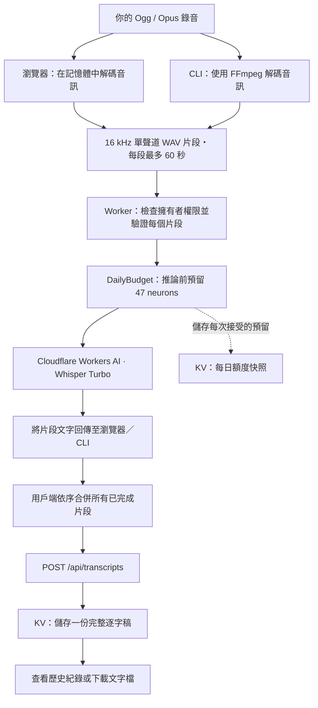
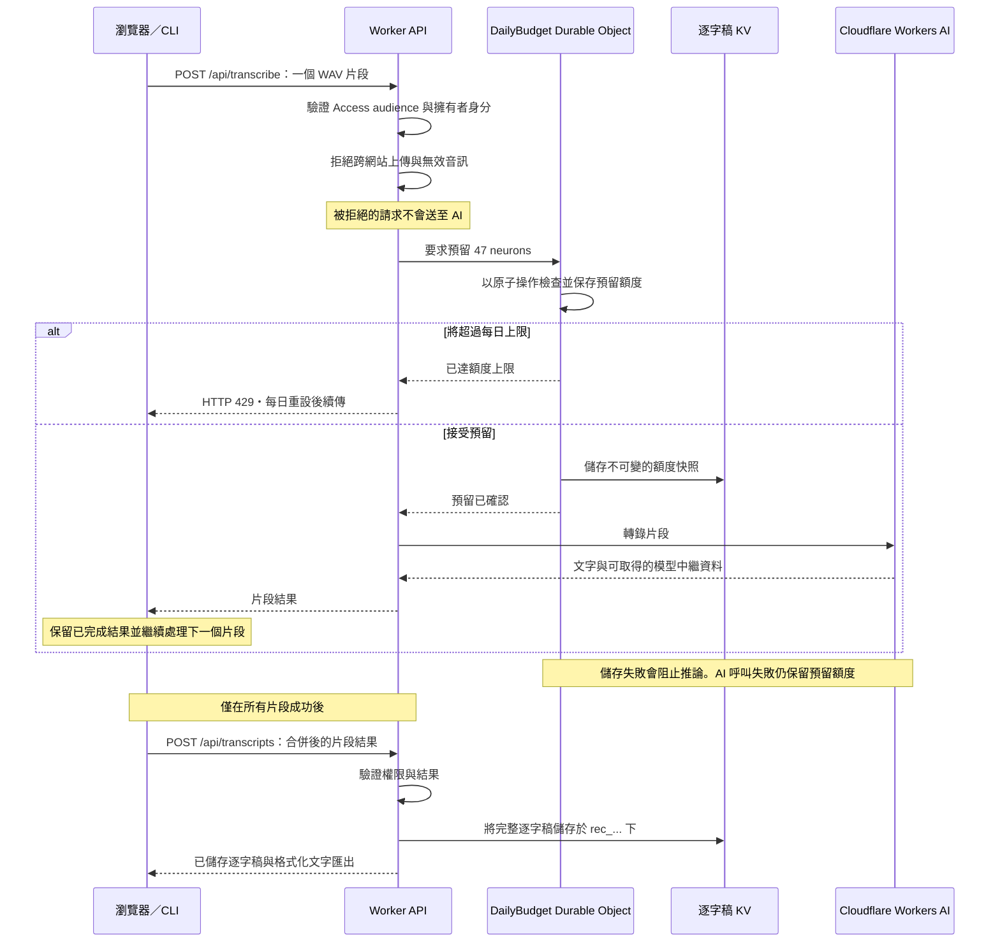

# WorkerWhisper

[English](README.md) | [日本語](README.ja.md) | **繁體中文**

一個用於 Ogg / Opus 音訊轉錄及保存逐字稿歷史紀錄的小型 Cloudflare Worker。產品名稱與模型無關；目前透過 Workers AI 使用 `@cf/openai/whisper-large-v3-turbo`。

**預估轉錄速度：**瀏覽器與 CLI 會根據已完成的片段估算速度。例如，若一段 60 秒音訊的上傳與轉錄耗時 10 秒，速度約為**即時的 6 倍**：30 分鐘錄音約需 **5 分鐘**，另加解碼與最終儲存時間。這是計算範例，不是實測效能；實際速度取決於錄音內容、網路與 Cloudflare AI 負載。

在你自己的 Cloudflare 帳戶部署私人實例。每個部署都有自己的擁有者、逐字稿儲存空間及 AI 額度。你需使用自己的 Cloudflare 憑證，並負擔自己的用量費用。公開版本庫提供程式碼；維護者不提供代管轉錄服務。

## 運作方式

在瀏覽器選擇錄音檔，或將檔案路徑傳給 CLI。你的電腦會將錄音轉換成小段 WAV 音訊，逐段上傳，再依序合併回傳的文字。Worker 會先檢查存取權限並預留每日額度，才將音訊送往 Cloudflare AI。



使用本專案**不需要**公開部署。本機模式會在你的電腦上執行 Worker，但 AI 模型仍在 Cloudflare 執行，並消耗你帳戶的額度。

| | 本機模式 | 部署模式 |
|---|---|---|
| 啟動 | `npm run dev` | 設定 Access 後執行 `npm run deploy` |
| 端點 | 僅限本機迴路介面的 `http://localhost:8787` | 受保護的 HTTPS 端點 |
| 存取 | 開發用的模擬擁有者身分 | 擁有者登入，或明確允許的服務權杖 |
| AI 推論 | 遠端 Cloudflare Workers AI | 遠端 Cloudflare Workers AI |
| 逐字稿與額度狀態 | 本機 KV 與 Durable Object 儲存空間 | Cloudflare KV 與 Durable Object 儲存空間 |

本機與部署後的額度分開計算。版本庫中的設定停用公開 Worker 與預覽網址；正式環境需要實際的 Access 應用程式 audience 與擁有者存取政策。

### 每次上傳的處理流程



額度於**台灣時間 08:00 / UTC 00:00** 重設。`GET /api/usage` 讀取 Durable Object 的權威狀態，供頁面顯示額度。KV 保留歷史副本，但不決定是否允許音訊片段。畫面顯示的是本應用程式保守預留的額度，而非整個 Cloudflare 帳戶的帳務用量。

### 儲存內容與續傳方式

| 位置 | 儲存資料 | 續傳方式 |
|---|---|---|
| 瀏覽器記憶體 | 解碼後的音訊與已完成片段的結果 | 保持頁面開啟並使用 **Retry / Resume**；重新整理或關閉會遺失進度 |
| CLI 輸出目錄 | `audio.pcm`、`job.json`、`partial.txt` 與最終的 `transcript.txt` | 再次執行相同指令，從檢查點讀取已完成片段 |
| 逐字稿 KV | `rec_...` 下的完整文字與中繼資料；`budget:YYYY-MM-DD:NNNNNN` 下的額度快照 | 透過歷史紀錄查看已完成的逐字稿 |
| Durable Object 儲存空間 | 每日預留次數與已預留的 neurons | Worker 重啟或同時收到多個請求時，仍可執行額度上限控管 |

音訊片段會送往 Cloudflare 處理，但 Worker 不會將音訊存入 KV。CLI 會在本機保留解碼後的音訊。某個片段失敗時，已完成的結果仍可用於續傳；只有完整合併的逐字稿才會存入歷史紀錄。若回應遺失，可能需要重做推論或最終儲存，因此重試可能再消耗一次預留額度，或產生重複的逐字稿。

## 執行

複製或下載版本庫後，在專案目錄執行以下指令。升級時保留既有的 `wrangler.jsonc`，只有首次安裝才複製範本。CLI 及其整合測試需要 FFmpeg。

```sh
npm ci
cp wrangler.example.jsonc wrangler.jsonc
npx wrangler login
npm run check
npm test
npm run dev
```

需要 Node.js 22.18 以上版本，以及已啟用 Workers AI 的 Cloudflare 帳戶。本機開發使用遠端 Workers AI 推論，可能產生費用；使用 `wrangler dev` 時，KV 資料保留在本機。

## 設定與部署

AI binding 與 TRANSCRIPTS namespace 設定於 `wrangler.jsonc`，範本為 `wrangler.example.jsonc`。將 `wrangler.example.jsonc` 複製為 `wrangler.jsonc`。在你的帳戶建立 namespace：

```sh
npx wrangler login
npx wrangler kv namespace create TRANSCRIPTS
```

將回傳的 namespace ID 填入 `wrangler.jsonc`。新部署請將 `name` 設為未使用的 Worker 名稱，並將 `vars.OWNER_EMAIL` 設為你的登入信箱。選擇由你 Cloudflare 帳戶管理的網域下的主機名稱（例如 `transcribe.example.com`），建立 Cloudflare Access 自行代管應用程式，涵蓋整個主機名稱且不限制路徑。只允許你的信箱，再將應用程式的 AUD 填入 `vars.ACCESS_AUD`。在 `wrangler.jsonc` 最外層加入以下設定，並換成自己的主機名稱：

```jsonc
"routes": [{ "pattern": "transcribe.example.com", "custom_domain": true }]
```

保持停用 `workers_dev` 與 `preview_urls`。完成下方 Access 檢查後，再執行 `npm run deploy` 並開啟設定的 HTTPS 主機名稱。Custom Domains 需要你 Cloudflare 帳戶中的有效 zone。參閱 [Custom Domains](https://developers.cloudflare.com/workers/configuration/routing/custom-domains/)。

Worker 的所有路由都需要 Cloudflare Access 驗證，包括歷史紀錄與上傳。它會檢查 Cloudflare 可信任的 `ctx.access` audience；偽造身分標頭無法取得存取權。Worker 也會檢查已驗證擁有者的電子郵件（`OWNER_EMAIL`，例如 `owner@example.com`）。其他已登入使用者會被拒絕。只有明確設定的擁有者服務權杖能存取相同的私人歷史紀錄。

啟用正式環境網址前：

1. 在 **Workers & Pages → your Worker → Access** 保護此 Worker，涵蓋正式環境與預覽。設定只允許你確切電子郵件的 Allow 政策，不使用 Everyone 或 Bypass 規則。若使用以主機名稱為基礎的應用程式，需涵蓋整個主機名稱，包括 `/api/*`，並保護所有其他路由。
2. 將應用程式的 audience（AUD）標籤複製到 `wrangler.jsonc` 的 `vars.ACCESS_AUD`。版本庫中的 `workerwhisper-local` 是開發用預設佔位值。未設定 audience 時回傳 503；缺少或不符合 Access 驗證時回傳 403。
3. 若使用 CLI 或本機伺服器，建立 Access 服務權杖與只允許該權杖的 **Service Auth** 政策。將 `vars.ALLOWED_SERVICE_TOKEN_ID` 設為其 Client ID；Worker 會從可信任的 Access 身分驗證 `service_token_id` 與 `service_token_status`。未設定時，正式環境的服務權杖請求會被拒絕。將權杖保留在本機環境中，絕不放入 Git、網址、瀏覽器 JavaScript 或逐字稿中繼資料。
4. 部署後確認未驗證的請求無法讀取歷史紀錄或觸發推論，再確認擁有者登入與 CLI 權杖正常運作。版本庫中的設定持續停用 `workers_dev` 與 `preview_urls`。

本機 `wrangler dev` 綁定 `127.0.0.1`，並透過 `access.dev.aud` 模擬 Access。若修改 `ACCESS_AUD` 或 `OWNER_EMAIL`，請將開發 audience 與身分電子郵件設為相同值。此模擬不會驗證本機用戶端：不要透過通道或區域網路介面對外開放開發伺服器。正式環境不使用此開發模擬。參閱 [Cloudflare Access for Workers](https://developers.cloudflare.com/workers/configuration/cloudflare-access/)。

私人回應使用 `Cache-Control: no-store`、禁止被嵌入框架，並抑制 referrer 資訊。跨網站的瀏覽器 POST 請求會被拒絕。已授權的非瀏覽器用戶端可不帶 Origin 標頭進行 POST。每次 AI 呼叫前都會執行每日預留額度上限檢查，詳見下文。逐字稿目前沒有自動到期或刪除 API。

## 每日額度與 KV 快照

`DAILY_NEURON_CAP` 預設為**每個 UTC 日 10,000 neurons**，接受 1 至 10,000 的整數。單一具名、以 SQLite 為基礎的 Durable Object（`DailyBudget`）會在推論前，為**每次嘗試的片段預留 47 neurons**。預留操作依序處理，因此同時上傳無法重複使用同一份剩餘額度。此上限每天最多接受 212 個片段（預留 9,964 neurons）。即使最後一段很短，也會預留 47；失敗或回應遺失的推論仍保留預留額度，因為 Cloudflare 可能已計費。沒有自動退還額度或重試。

此上限根據目前 Whisper Turbo 每分鐘音訊 46.63 neurons 的費率，保守估算本功能啟用後本應用程式的呼叫用量。它不是 Cloudflare 的計費量表。較早的呼叫、其他 Worker，以及本機與部署環境的用量分開計算；應用程式的 10,000-neuron 上限無法保證整個帳戶不產生付費用量。若需控制在今天剩餘的免費額度內，請降低應用程式上限，為其他用量保留空間。變更模型或價格時，請重新確認每次預留量。

`GET /api/usage` 回傳目前上限、已預留及剩餘 neurons、請求次數、剩餘片段數與下次重設時間戳記。頁面會在初次載入、按下 Refresh，以及嘗試轉錄後讀取此資訊。重設時間為 **UTC 00:00 / Asia/Taipei 08:00**。達到上限時，在呼叫 Workers AI 前回傳 HTTP 429；CLI／瀏覽器已完成的片段仍可於隔日續傳。

每次接受預留時，都會在現有 `TRANSCRIPTS` KV namespace 的 `budget:YYYY-MM-DD:NNNNNN` 下寫入私人快照。獨立且不可變的 key 可避免 KV 對單一 key 的寫入競爭。快照不包含錄音文字或憑證，也不會出現在逐字稿歷史紀錄中。Durable Object 是額度控管的依據；KV 的最終一致副本用於歷史紀錄，不用於判斷是否允許上傳。儲存或快照寫入失敗會阻止推論。目前快照與逐字稿皆不會自動到期。

為使上限可驗證，`/api/transcribe` 現在只接受瀏覽器／CLI 產生的標準 PCM16 WAV 片段：16 kHz、單聲道、最多 60 秒，且檔案與資料長度必須一致。Ogg/Opus 原始檔仍可透過這兩種介面使用。**API 不再接受直接上傳原始 Ogg/Opus**；請先透過 CLI／瀏覽器轉換。既有逐字稿仍可讀取。部署時會建立設定中的 `DailyBudget` Durable Object migration；逐字稿 KV namespace 會保留。

## CLI 示範（Ogg / Opus）

### 1. 準備專案

需要 Node.js 22.18 以上版本、PATH 中可執行的 FFmpeg，以及已啟用 Workers AI 的 Cloudflare 帳戶。在 macOS 使用 Homebrew 安裝 FFmpeg：

```sh
brew install ffmpeg
```

在專案目錄開啟終端機並安裝相依套件：

```sh
npm ci
cp wrangler.example.jsonc wrangler.jsonc
node --version
ffmpeg -version
```

### 2. 啟動 Worker

在同一個終端機登入 Cloudflare 並啟動本機 Worker：

```sh
npx wrangler login
npm run dev
```

保持此終端機執行。Wrangler 會顯示本機網址，通常為 `http://localhost:8787`。

### 3. 上傳錄音

在專案目錄開啟第二個終端機。先使用一段 2–3 分鐘的錄音，依檔案格式執行下列其中一個指令：

```sh
npm run demo -- ./meeting.opus
npm run demo -- ./meeting.ogg
```

檔名含空白時，請以引號包住路徑：

```sh
npm run demo -- "/path/to/My meeting.opus"
```

若要在逐字稿包含錄音開始時間與計算出的結束時間，請提供含時區偏移量的實際時間戳記。台灣範例：

```sh
npm run demo -- ./demo.opus --recording-start "2026-01-01T12:00:00+08:00"
```

時間戳記不會從檔名或檔案修改時間推算。未提供時，錄音開始與結束時間為 `Unknown`。續傳時使用相同指令，或省略此選項以保留已儲存的開始時間。

腳本會在本機將音訊轉換成磁碟上的 16 kHz 單聲道 PCM，將每個連續 60 秒片段包裝為獨立的 PCM16 WAV，再依序上傳至現有 Worker。它會顯示進度、保存已完成回應的檢查點，最後將合併的逐字稿存入 Worker 歷史紀錄，並在本機存為 `transcript.txt`。

例如，130 秒的錄音會產生三個片段：60 秒、60 秒與 10 秒。你不需要自行分割原始檔。

CLI 與瀏覽器會在片段完成後，根據實測每秒音訊的處理時間顯示預估剩餘時間。續傳時只使用新片段估算速度。估算不包含解碼與最終儲存，並會受網路及推論速度影響。

### 4. 閱讀逐字稿

預設輸出位置為錄音旁的 `meeting.opus.workerwhisper-demo/`。內容包含 `audio.pcm`、`job.json`、成功完成片段後的 `partial.txt`，以及全部完成後的 `transcript.txt`。這些預設目錄已被 Git 忽略。每小時音訊的 PCM 約占 115 MB；記憶體用量限制在單一片段大小。不再需要音訊與逐字稿時，請刪除此目錄。

```sh
cat ./meeting.opus.workerwhisper-demo/transcript.txt
```

若要續傳更名前建立的工作，請傳入 `--out ./meeting.opus.edgewhisper-demo`，使用原有的檢查點目錄。

### 5. 發生錯誤後續傳

發生錯誤後再次執行相同指令，便會從第一個未完成片段繼續，即使終端機已重啟也一樣。若輸入檔案或 Worker 網址改變，需使用新的輸出目錄。已完成的工作會直接結束，不重複呼叫 AI。若程序被強制終止，請先確認沒有其他執行個體使用該目錄，才移除 `running.lock`。

續傳時請保留輸出目錄；`job.json` 包含已完成片段的回應。若重啟了 Worker 終端機，請先再次執行 `npm run dev`，再繼續示範。

### 選項與疑難排解

選擇端點或輸出位置（Wrangler 顯示不同連接埠時，使用 `--url`）：

```sh
npm run demo -- ./meeting.opus --url http://localhost:8787 --out ./meeting.opus.workerwhisper-demo
```

網址必須是 Worker 的 origin。遠端 origin 需要 HTTPS，以及 Access 服務權杖的 `CF_ACCESS_CLIENT_ID` 與 `CF_ACCESS_CLIENT_SECRET` 環境變數。在終端機安全設定這兩個變數後，執行：

```sh
npm run demo -- ./meeting.opus --url https://your-protected-worker.example.com
```

憑證不會傳送至 HTTP localhost 端點，且 CLI 會拒絕重新導向，避免將上傳內容或憑證轉送至其他目的地。CLI 不提供互動式瀏覽器登入。參閱 [Access 服務權杖](https://developers.cloudflare.com/cloudflare-one/access-controls/service-credentials/service-tokens/)。

新建的 CLI 輸出目錄與檔案僅限你的作業系統使用者存取（Unix 上目錄為 0700、檔案為 0600）；既有權限不會變更。它們仍包含解碼後的音訊、逐字稿與來源絕對路徑，不再需要時請刪除。

本機 Workers AI 推論會消耗帳戶的每日額度。沒有自動重試：修正錯誤或等待額度重設後，再執行一次。若推論後回應遺失，未完成片段可能再次計費；若最終儲存回應遺失，再次執行可能建立重複的歷史紀錄。

### 透過 API 讀取 neuron 用量

Cloudflare 的 GraphQL Analytics API 透過 `aiInferenceAdaptiveGroups.sum.totalNeurons` 提供整個帳戶的 Workers AI 用量。查詢 UTC 當日從 `00:00:00Z` 到目前時間的用量，不依模型或 Worker 篩選。使用具備讀取分析資料權限的帳戶範圍 API 權杖。

將此查詢送至 `https://api.cloudflare.com/client/v4/graphql`，使用 `Authorization: Bearer <token>`，JSON 本文包含 `query` 與 `variables`：

```graphql
query($account: string!, $start: Time!, $end: Time!) {
  viewer {
    accounts(filter: {accountTag: $account}) {
      aiInferenceAdaptiveGroups(
        limit: 1,
        filter: {datetime_geq: $start, datetime_lt: $end}
      ) {
        sum { totalNeurons }
      }
    }
  }
}
```

以 10,000 減去回報的總量，最低取零，即為剩餘免費額度。再除以 46.63，可估算剩餘 Whisper Turbo 音訊分鐘數。這是回報的分析資料，可能延遲或經過取樣，並非即時預留機制或支出上限。即使 HTTP 狀態為 200，也要檢查 GraphQL `errors`；API 錯誤不可視為零用量。分析憑證應放在瀏覽器程式碼之外。參閱 [GraphQL 查詢基礎](https://developers.cloudflare.com/analytics/graphql-api/getting-started/querying-basics/) 與 [Workers AI 定價](https://developers.cloudflare.com/workers-ai/platform/pricing/)。

- **FFmpeg 失敗：**確認 `ffmpeg -version` 正常，且錄音可以開啟。
- **Connection refused / fetch failed：**啟動 `npm run dev`，並確認 `--url` 符合 Wrangler 的本機網址。
- **額度用盡：**免費額度為每天 10,000 neurons，由帳戶的所有 Workers AI 用量共用。於 Asia/Taipei 08:00 重設。分割音訊不會減少計費的音訊總分鐘數。參閱 [Cloudflare 定價](https://developers.cloudflare.com/workers-ai/platform/pricing/)。
- **來源檔案或 Worker 網址改變：**選擇新的 `--out` 目錄，不要重用其他工作的進度。

執行 `npm run demo -- --help` 可查看所有 CLI 選項。

## 瀏覽器示範

啟動 `npm run dev` 後，開啟 Wrangler 顯示的本機網址：

1. 選擇 `.ogg` 或 `.opus` 檔案。
2. 視需要輸入錄音開始時間。
3. 點擊 **Upload & Transcribe**。瀏覽器會自動分割並上傳片段。
4. 觀察片段進度與部分文字，完成後點擊 **Download transcript (.txt)**。

保持頁面開啟。發生錯誤後使用 **Retry / Resume**；重新整理或關閉會遺失瀏覽器進度。CLI 將進度存到磁碟，可在重啟後續傳。

## 行為

- 可選擇 `.ogg` 或 `.opus` 檔案，包括超過 10 MiB 的檔案。瀏覽器以 16 kHz 解碼錄音、混合為單聲道，並依序傳送 60 秒 PCM16 WAV 片段（每段約 1.92 MB）。Worker 的每次音訊請求仍限制為 10 MiB；原始音訊不會被儲存。
- 不指定語言，讓模型自行偵測。初始提示提供繁體中文、英文、泰文與菲律賓語的情境。這是引導，不保證語言切換辨識準確或一定輸出繁體中文。
- 片段文字依序合併並存為一份逐字稿，包含總轉錄時間，以及可取得時的字詞數。合併逐字稿沒有 VTT；單片段上傳可能包含模型的 VTT 輸出。歷史紀錄由新到舊排列，每頁 20 筆，透過 cursor 載入更多。
- KV 採最終一致性：新逐字稿可能需要一段時間才出現在歷史紀錄，或可從其他位置讀取。

模型結構描述：https://developers.cloudflare.com/workers-ai/models/whisper-large-v3-turbo/

## 逐字稿下載

轉錄完成或查看歷史紀錄時，使用「Download transcript (.txt)」。檔名為 `cloud-YYMMDD-HHMMSS_{original_filename}.txt`，包含來源副檔名。時間戳記為轉錄請求開始的 Asia/Taipei 時間；之後再次下載時維持相同。

文字包含中繼資料與逐字稿區段。選填的錄音開始欄位使用瀏覽器本地時間；結束時間根據解碼後的音訊長度計算（直接透過 API 上傳單片段時，使用已驗證的 WAV 長度）。缺少的中繼資料標為 Unknown。音訊大小以十進位 MB 表示上傳檔案大小，轉錄時間則量測 AI 呼叫耗時。轉換欄位記載 60 秒 WAV 片段，不會虛構已存於磁碟的轉換檔案或宣稱使用 CUDA 裝置。

若提供錄音開始時間，標題日期使用其 Asia/Taipei 日期；否則使用轉錄請求日期。下載檔名仍使用請求時間戳記。CLI 包含來源絕對路徑；瀏覽器無法取得此資訊，因此瀏覽器匯出的此欄位為 Unknown。所有匯出的時間戳記皆使用 Asia/Taipei。

格式範例（下列數值僅供示意；匯出欄位名稱維持英文）：

```text
Voice Memo Transcript - 20260101

## Metadata
Recording Start Time: 2026-01-01 12:00
Recording End Time: 2026-01-01 12:02
Source File: demo.opus
Source Location: /recordings/demo.opus
Converted Audio: 60-second WAV chunks (16 kHz, mono, PCM16)
Audio Size: 3.00 MB
Audio Length: 2.00 min
Transcribe Backend: Cloudflare Workers AI
Transcribe Device: Cloudflare-managed
Transcribe Model: @cf/openai/whisper-large-v3-turbo
Transcribe Time: 0m 30s
Recording Timezone: Asia/Taipei

## Transcript
Transcribed text goes here.
```

版本庫中的設定持續停用公開網址。啟用前請套用正式環境的 Access 政策與 audience。

## 長時間錄音

頁面會顯示片段進度，並在記憶體中保留已完成的結果。若片段或最終儲存失敗，請保持頁面開啟並使用 Retry / Resume：已完成片段不會重新轉錄。失敗後可下載部分文字。關閉或重新整理頁面會捨棄記憶體中的工作。只有完整合併的逐字稿才會存入 KV。

瀏覽器解碼需要 Ogg/Opus 編碼支援，以及足以容納整段解碼後錄音的裝置記憶體；分割會降低上傳與 Worker 的記憶體需求，但不會降低瀏覽器解碼所需記憶體。瀏覽器 API 需要完整檔案：https://developer.mozilla.org/en-US/docs/Web/API/BaseAudioContext/decodeAudioData

片段連續且不重疊；邊界上的字詞可能失去上下文。若影響準確度，下一步可改善為依靜音位置切分。目前上限為 1,000 個片段（1,000 分鐘），以及 2 MiB 的最終 JSON 請求。

## 授權

[MIT](LICENSE).
